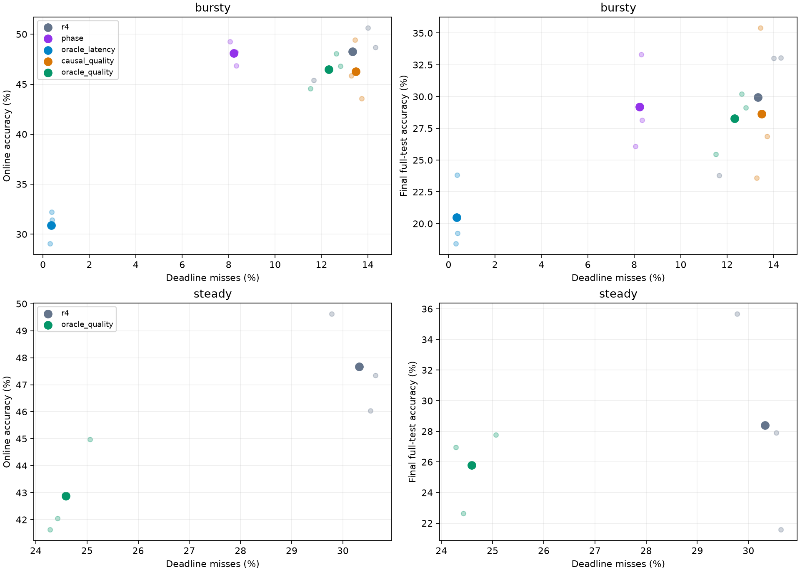
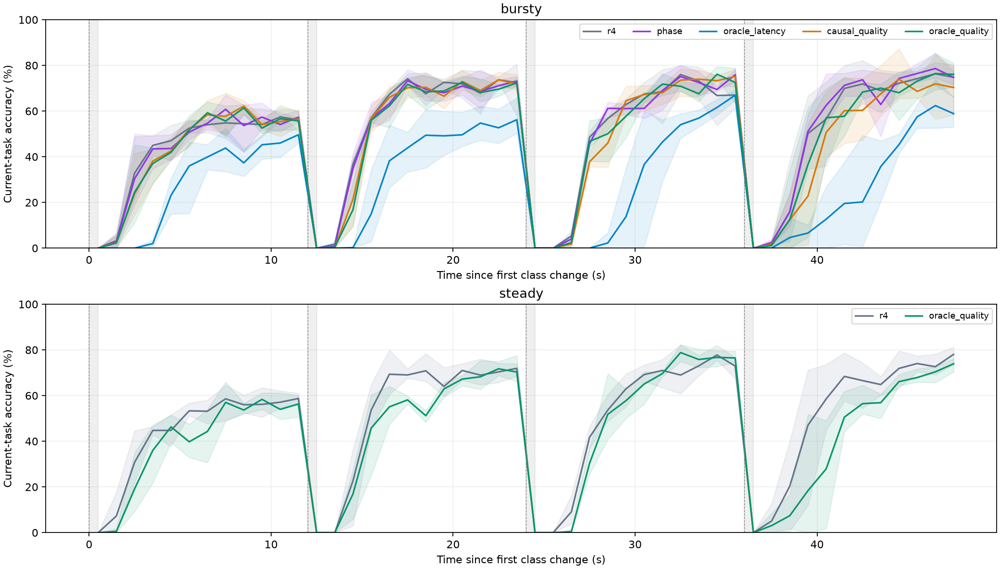
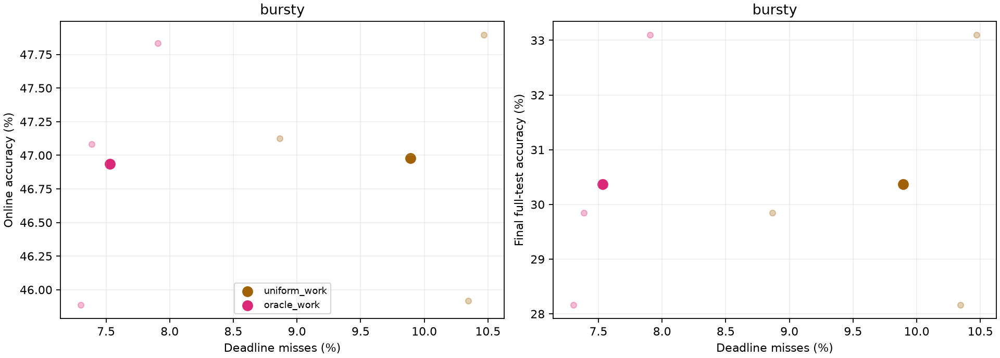

# 已知未来到达能否让持续学习又快又好

2026-10-17，NVIDIA Thor GPU0 / MAXN。

**已验证未来到达信息可以减少超时、保持最终学习结果；本轮尚未验证模型学得更好或适应更快。** 完成21次固定48秒预算的正式对照及6次共同工作整窗对照，共259200个请求。整窗对照中，超时率9.89%→7.53%，但最终模型完全相同、适应时间相同，在线准确率46.98%→46.93%。单步质量策略在三个种子的突发／平稳流上都减少了超时，却也都降低了在线准确率；最终准确率有升有降，均值下降。

## 这次怎样直接检验学习质量

此前[固定训练工作量实验](../arrival_oracle/QUOTA_RESULTS.md)保持训练数据、顺序和步数相同，最终模型也相同。本实验保持**可用数据、初始状态和在线时间预算相同**，允许实际完成的更新数不同，直接评估学习过程与最终模型。

CIFAR10分五个任务，每任务两个类别。先在任务0上训练5轮、160步；四个新任务随后各持续12秒，训练及验证标签在任务出现0.5秒后释放。各任务可用2048个训练样本和另256个验证样本。请求80%来自当前类别、20%来自历史类别，使用独立测试集；负载与类别变化分别控制，48秒内9600个请求，33 ms SLO。

所有方法共享同种子的起始模型及Adam状态，使用项目ResNet56、Adam lr=.001，显式有放回采样64个当前样本和64个回放样本；历史回放最多2000个样本。该时钟驱动执行器独立于原Avalanche训练入口，`r4`表示其中的R4式FIFO基线，不能把数值直接接续旧R4报告。训练计算约54 ms，不可抢占；准备每8个样本提供FIFO服务点。

- **在线准确率**：全部请求的预测正确比例，包含逾期请求；会受到推理实际服务时间的影响。
- **按时正确率**：全部请求中，同时预测正确且在33 ms内返回的比例。
- **阶段末已见类准确率**：12／24／36／48秒模型快照在已见类别上的均衡测试准确率，再对四个时点取均值。统一使用每类200个固定测试样本，检查与请求排队时间无关的模型质量。
- **最终准确率**：48秒停止更新后的模型，在全部10000个测试样本上的准确率。
- **适应时间**：当前任务连续两个1秒窗口准确率达到60%的第二个窗口末时刻，从任务出现起算；12秒内未达到则记12秒，并报告未达到数量。
- **遗忘**：任务0–3在已见阶段快照中的最佳准确率，减去最终快照准确率，再取均值。较低遗忘还需结合实际学到的准确率判断。

48秒后不再训练；排空请求及全部快照评估发生在模型冻结后。正式21次运行没有训练跨过阶段截止边界。所有策略共同知道阶段边界和标签释放规则；只有oracle额外读取未来请求时间戳。未来测试标签、预测正确率和实际执行耗时均不用于决策。完整方法见[DESIGN.md](DESIGN.md)。

## 正式矩阵

种子211、307、419，每个运行点3次，顺序轮换。表内均为均值；逐次结果和样本标准差保存在归档CSV。

| 负载 | 方法 | 超时率 % | 在线准确率 % | 按时正确率 % | 最终准确率 % | 完成更新数 |
|---|---|---:|---:|---:|---:|---:|
| 突发 | R4式FIFO | 13.333 | 48.247 | 41.438 | 29.957 | 509.67 |
| 突发 | 已知周期 phase | 8.229 | 48.115 | 43.951 | 29.180 | 486.67 |
| 突发 | 纯避险 oracle_latency | 0.358 | 30.899 | 30.774 | 20.487 | 210.33 |
| 突发 | 无未来质量策略 causal_quality | 13.483 | 46.285 | 39.816 | 28.623 | 438.67 |
| 突发 | 未来质量策略 oracle_quality | 12.323 | 46.493 | 40.490 | 28.263 | 432.00 |
| 平稳 | R4式FIFO | 30.319 | 47.674 | 32.819 | 28.387 | 439.33 |
| 平稳 | 未来质量策略 oracle_quality | 24.590 | 42.878 | 31.729 | 25.793 | 342.33 |

周期参照知道每秒前200 ms为高负载，不知道具体随机到达。纯避险策略只在预测不会额外造成超时时训练，不设等待上限。

在同为200请求/秒时，平稳流的R4式基线平均推理调用2972次、每批3.23个请求、累计推理18.84秒；突发流对应2155次、4.46个请求和13.99秒。平稳到达更难形成批量，约多消耗4.85秒推理时间，与完成更新数439.33／509.67的差异相符。因此，平均QPS相同不等于可用训练时间相同。

两种质量策略使用相同的已释放验证探针：每4步观察一次当前／历史验证表现，用真类概率增量估计每步质量收益。比较“立即训练”和“先服务下一批再训练”的预期按时正确请求数，前瞻最多1秒。无未来版用过去1秒平均到达率生成均匀未来点，oracle版使用真实时间戳；其余公式、FIFO执行器和质量信息相同。该质量估计和单步动作模型均为启发式，不是真实未来准确率oracle。



### 质量感知的单步oracle仍未同时改善两项目标

相对R4式基线，突发超时率平均降低1.010个百分点，但在线准确率降低1.753个百分点、最终准确率降低1.693个百分点。平稳流对应超时降低5.729个百分点，在线准确率降低4.795个百分点、最终准确率降低2.593个百分点。

| 负载 | 种子 | 超时变化 / pp | 在线准确率变化 / pp | 最终准确率变化 / pp | 阶段末已见类准确率变化 / pp | 更新数变化 |
|---|---:|---:|---:|---:|---:|---:|
| 突发 | 211 | −1.198 | −3.813 | −3.890 | −2.015 | −79 |
| 突发 | 307 | −1.688 | −0.625 | −2.860 | −3.783 | −75 |
| 突发 | 419 | −0.146 | −0.823 | +1.670 | +0.025 | −79 |
| 平稳 | 211 | −6.208 | −5.313 | +1.080 | −1.981 | −98 |
| 平稳 | 307 | −4.719 | −4.656 | −7.890 | −3.346 | −94 |
| 平稳 | 419 | −6.260 | −4.417 | −0.970 | −2.588 | −99 |

相同时间内训练量减少，是需要正视的代价。实际减少量包含等待、推理服务与控制开销，不能全部解释为主动等待。未来信息相对本次无未来质量策略，在突发流上降低超时1.160个百分点、增加在线准确率0.208个百分点；最终准确率反而平均低0.360个百分点，逐种子方向混合。这个比较不支持稳定的最终学习收益。

### 统一时刻的模型评估也没有显示整体质量提高

| 负载 | 方法 | 四个阶段末已见类准确率均值 % | 适应时间 s | 未达60%的任务数 / 12 | 平均遗忘 / pp |
|---|---|---:|---:|---:|---:|
| 突发 | R4式FIFO | 46.878 | 7.583 | 2 | 53.688 |
| 突发 | 已知周期 | 46.440 | 7.583 | 2 | 53.438 |
| 突发 | 纯避险oracle | 38.663 | 11.750 | 8 | 53.542 |
| 突发 | 无未来质量策略 | 44.135 | 8.167 | 1 | 51.688 |
| 突发 | 未来质量策略 | 44.954 | 7.833 | 2 | 53.521 |
| 平稳 | R4式FIFO | 45.184 | 7.583 | 1 | 53.292 |
| 平稳 | 未来质量策略 | 42.545 | 8.917 | 3 | 57.063 |

这排除了仅由请求排队、使用不同服务时刻模型造成的解释：在统一阶段末，未来单步质量策略的已见类准确率均值也较低。阶段末评估是四个离散时点，不能当作整个48秒模型准确率积分。

纯避险将突发超时压到0.358%，却只完成约210步，适应明显变慢。它没有同时完成本次学习目标。简单周期参照反而取得最高的突发按时正确率43.951%，但最终准确率仍没有稳定超过R4。降低遗忘也需结合学习水平：没有充分学会新类的策略，其“历史最佳减最终”可能较小，不能据此单独判定CL更好。



## 相同学习工作下的整窗对照

补充对照使用相同checkpoint、数据、标签释放和48秒预算，每阶段固定114步，共456步。均匀策略按10步/秒安排完成时刻；整窗策略知道真实到达，在整个1秒窗口规划剩余更新，以`clip(p+k×max(g,0),0,1)`估计更新后的质量。它以从当前队列状态出发、在同一成本模型中执行均匀节奏得到的完成时间作参考约束。推理批成本由过去64次服务拟合，未来真实耗时不可见。

| 方法 | 超时率 % | 在线准确率 % | 按时正确率 % | 最终准确率 % | 阶段末已见类准确率 % | 适应时间 s | 在线更新数 |
|---|---:|---:|---:|---:|---:|---:|---:|---:|
| 无未来均匀 uniform_work | 9.892 | 46.979 | 41.941 | 30.370 | 45.524 | 8.000 | 456 |
| 未来整窗 oracle_work | 7.531 | 46.934 | 43.101 | 30.370 | 45.524 | 8.000 | 456 |

| 种子 | 超时变化 / pp | 在线准确率变化 / pp | 按时正确率变化 / pp | 每阶段更新数 | 最终模型参数及BN |
|---|---:|---:|---:|---|---|
| 211 | −1.479 | −0.042 | +0.740 | 两组均114／114／114／114 | 完全一致 |
| 307 | −2.563 | −0.062 | +1.052 | 两组均114／114／114／114 | 完全一致 |
| 419 | −3.042 | −0.031 | +1.687 | 两组均114／114／114／114 | 完全一致 |

整窗规划使超时相对减少23.87%，每9600个请求平均增加约111个按时正确结果。逐请求分解中，按时状态贡献+1.191个百分点，服务时预测结果变化贡献−0.031个百分点，净增1.160个百分点。学习结果保持一致，不能将该收益称为模型学得更好。

三个种子各48个窗口均找到模型内可行解，参考模拟和搜索平均52.6 ms，拟合与其他控制开销也包含在在线时钟中。任一整秒边界的训练进度最多相差1步。全部更新完成时间相对均匀策略平均只提前0.93 ms，约51.2%的更新较早，个别更新反而晚约130 ms；没有系统性提前学习的证据。两组阶段末质量、最终全测试准确率、遗忘及适应时间均相同。

相对无配额R4，整窗策略最终准确率均值高0.413个百分点，但三个种子的变化为−3.17／+0.05／+4.36个百分点；在线准确率反而低1.313个百分点，阶段末已见类准确率低1.355个百分点，适应时间多0.417秒。这个运行点仍不支持稳定的“又快又更好”。它比单步质量策略更好的一部分原因是保证了更多训练进度，不能全部归给未来信息。

补充两组使用同一包装入口，总墙钟均值62.14／62.21秒；主矩阵入口约60秒，入口差异未单独拆分，不将该差异归因于调度。各组在线学习预算仍统一为48秒。

整窗初版诊断另存：名义逐步截止在高峰队列结束时已经过去，seed211有44/48个窗口回退；阶段目标115步与均匀策略的末尾保护也不一致。4次完整诊断及1次中止运行保留在`work-infeasible/`，没有并入上表。修订后的6次对照全部完成、每阶段均为114步、没有跨阶段训练。



## 结果对研究问题的含义

1. 精确到达可以帮助避开阻塞，学习质量还取决于同一预算内完成哪些更新、何时生效及旧类保留。未来信息不自动提供这些价值信息。
2. 本次用短期真类概率变化近似训练收益，单次更新比较未充分表示多步学习后才出现的准确率改善。归档的探针与增益校准记录用于分析这一近似，未声称该估计已经准确。
3. 整窗匹配工作对照保持了学习质量，但没有使学习本身更快。下一步应检验一段训练后才生效的质量收益及必要进度约束，而非仅提高到达预测精度。
4. 该结果限定于本次类增量流、经验回放和具体调度器。它检验了可实现机制，没有求解所有可行调度下的数学最优学习／延迟上限，也不证明更强机制无法同时改善两项目标。

## 环境与复现

Conda `rtcl`，aarch64、Thor GPU0 / MAXN、PyTorch2.14.0+cu132、torchvision0.29.0+cu132。CPU库线程均为1，GPU实验串行。计时前以全零虚拟输入预热5次反传，再恢复参数、BN、Adam和随机数状态，最后4次稳定计算作为初始耗时历史。初始模型预训练为所有策略共享的成本，不计入各自48秒在线预算。

初始5次冷启动pilot及后续5次预热pilot使用seed19，均不进入正式均值。冷启动第一步约222 ms、后续约54 ms，曾使纯避险几乎停训；质量策略初版的积压准备语义也与动作模型不一致。正式前修正为共同FIFO及恢复学习状态的预热，保留全部诊断。更早一次验证探针未混合类别的未完成检查也保留，不计入结果。

75项单元测试通过，12种实际GPU执行配置的环境检查通过。原始日志、逐请求／更新／探针／窗口计划JSON、阶段评估及运行源码保存在`output/thor-arrival-cl-20261017/`；最终模型位于各工作目录的`horizon_model.pt`。精简证据归档于[thor-20261017/](thor-20261017/)。主要入口：[主矩阵均值与标准差](thor-20261017/main/summary.csv)、[主矩阵配对](thor-20261017/main/paired_comparisons.csv)、[阶段末模型质量](thor-20261017/main/boundary_learning.csv)、[整窗均值](thor-20261017/work/summary.csv)、[跨阶段配对与更新时间](thor-20261017/comparison/paired_comparisons.csv)、[最终模型一致性](thor-20261017/comparison/analysis.json)。只有三个配对种子，不能把请求数量当作独立重复数。

```bash
bash environment/run.sh experiments/optimization/arrival_cl/matrix.py \
  --phase pilot --gpu 0 --output output/arrival-cl-repeat/pilot
bash environment/run.sh experiments/optimization/arrival_cl/matrix.py \
  --phase main --gpu 0 --output output/arrival-cl-repeat/main
bash environment/run.sh experiments/optimization/arrival_cl/analyze.py \
  --directory output/arrival-cl-repeat/main
bash environment/run.sh experiments/optimization/arrival_cl/work_matrix.py \
  --main output/arrival-cl-repeat/main --gpu 0 --output output/arrival-cl-repeat/work
bash environment/run.sh experiments/optimization/arrival_cl/analyze.py \
  --directory output/arrival-cl-repeat/work
bash environment/run.sh experiments/optimization/arrival_cl/compare_work.py \
  --main output/arrival-cl-repeat/main --work output/arrival-cl-repeat/work \
  --output output/arrival-cl-repeat/comparison
```
