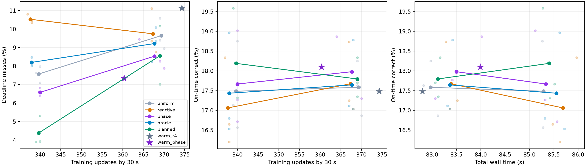
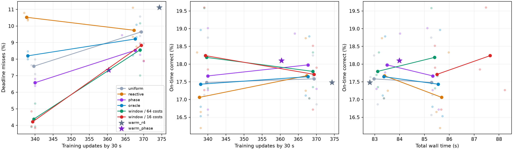

# 未来到达信息的收益：控制训练进度后的实测

2026-10-17，NVIDIA Thor GPU0 / MAXN。

本轮完成**46次GPU运行：36次冻结矩阵、6次独立成本诊断、4次pilot**。42次非pilot共252000个请求、33180步训练；46次均完成规定790步和最终10000样本测试。同种子跨策略、跨阶段的最终权重／BN缓冲及请求轨迹一致，逐请求指标已复核。

**未来信息存在可利用的收益空间，而且收益不必靠大幅推迟训练换取。** 在共同的8步/秒训练配额下，无未来信息的均匀调度超时率为7.57%，知道精确到达的整窗规划降至4.38%，相对下降42.1%；按时正确率从17.48%升至18.19%。两者30秒时平均都完成339.67步，总墙钟85.29→85.40秒。9步/秒时相应超时下降11.3%，按时正确率增加0.21个百分点，说明可调度余量会显著限制未来信息的价值。

这组对照解决了[首轮纯避险实验](README.md)中的关键混淆：首轮oracle降低超时的同时，把大量训练推迟到了请求窗口之后。这里给所有配额策略相同的训练任务释放规则，核对每秒实际完成量，再比较启动位置。原首轮数据和负结果完整保留。

## 设置与信息边界

固定SplitCIFAR10、ResNet56、Replay、1 epoch、训练batch64、FIFO推理最多32个请求。先完成100步训练，再启动6000个唯一请求的30秒到达流，SLO为33 ms。每秒80%的请求集中在前200 ms，其余分布在后800 ms，各段内随机到达。每次完成全部790个训练更新及最终10000样本测试。

每秒释放8或9步训练工作，未完成部分带到下一秒；配额耗尽后等待，同时继续服务推理。30秒后取消配额，完成剩余训练。避让不能超过因果成本估计给出的剩余时间；因此配额是共同工作约束，实际完成时间仍需实测。8／9步时，30秒累计目标分别为340／370步，含100步预热。

| 策略 | 到达信息 | 决策方式 |
|---|---|---|
| R4 | 已到达请求 | 空队列即训练，无配额 |
| 均匀 uniform | 时钟、已完成更新数 | 按配额均匀安排完成时刻，不读取未来到达 |
| 反应式 reactive | 过去响应完成时刻 | 等待一个由阻塞长度估计的安静期 |
| 周期 phase | 已知每秒前200 ms为高负载段 | 避免训练的易超时窗口覆盖高负载段 |
| 局部 oracle | 精确未来到达时间戳 | 比较当前一步训练相对等待的新增超时风险 |
| 整窗 planned | 精确未来到达时间戳 | 在1秒窗口内规划剩余训练位置，先最小化超时，再优先提前完成训练 |

phase是已知生成器周期的参照，未训练预测器，也不知道具体随机到达。planned以过去计算段中位数、主机准备均值、推理均值建立成本模型，在2 ms状态桶上搜索；CPU规划耗时计入控制与墙钟。所有策略均不知道未来标签、预测正确性和实际运行耗时。完整配额与规划设计见[DESIGN_QUOTA.md](DESIGN_QUOTA.md)。

正式冻结矩阵为3个种子211／307／419 × 12策略，共36次，轮换运行顺序。另有独立的近期成本诊断，方法与结果在后文单列。pilot使用seed19，不并入正式均值。

## 冻结矩阵：全部GPU结果

表为三个种子的均值。按时正确率为全部6000个请求中同时正确且在33 ms内完成的比例；逾期请求全部处理。总墙钟含初始化、预热、全部训练、请求服务、最终测试与退出。训练进度包含100步预热。

| 配额 | 策略 | 超时率 % | P95 ms | 按时正确率 % | 总墙钟 s | 30秒训练步数 |
|---|---|---:|---:|---:|---:|---:|
| 无 | R4 | 11.122 | 49.10 | 17.483 | 82.802 | 374.33 |
| 无 | 周期 | 7.339 | 42.36 | 18.100 | 83.992 | 360.33 |
| 8 | 均匀 | 7.572 | 43.43 | 17.483 | 85.288 | 339.67 |
| 8 | 反应式 | 10.528 | 46.27 | 17.061 | 85.690 | 337.67 |
| 8 | 周期 | 6.578 | 40.55 | 17.667 | 85.337 | 340.00 |
| 8 | 局部oracle | 8.200 | 42.74 | 17.433 | 85.553 | 338.00 |
| 8 | 整窗规划，64条成本历史 | **4.383** | **30.17** | **18.189** | 85.404 | 339.67 |
| 9 | 均匀 | 9.644 | 45.91 | 17.583 | 82.971 | 369.33 |
| 9 | 反应式 | 9.744 | 46.87 | 17.672 | 83.390 | 367.33 |
| 9 | 周期 | 8.533 | 43.86 | 17.978 | 83.500 | 367.67 |
| 9 | 局部oracle | 9.217 | 44.89 | 17.644 | 83.367 | 367.67 |
| 9 | 整窗规划，64条成本历史 | 8.556 | 42.62 | 17.794 | 83.119 | 369.00 |

均匀节奏已经是有效的无未来对照。不能把R4到整窗规划的全部改善归于预测：其中还包含主动限制训练速率的作用。局部oracle也没有稳定超过均匀或周期调度；知道未来后，如何在整个工作窗口内安排训练同样重要。

相对无配额R4，8步整窗规划的总墙钟增加3.14%，流末少完成34.67步；9步则增加0.38%、少5.33步。无配额周期参照已经达到18.10%的按时正确率、83.99秒墙钟。精确未来信息的主要归因证据来自同配额比较，当前运行点并未在延迟、质量和训练进度上全面支配其他方法。

### 配对证据：整窗规划相对均匀调度

| 配额 | 种子 | 超时率变化 / pp | 按时正确率变化 / pp | 30秒训练步数差 | 任一整秒边界最大步数差 |
|---|---:|---:|---:|---:|---:|
| 8 | 211 | −2.317 | +0.533 | +1 | 1 |
| 8 | 307 | −4.083 | +0.833 | −1 | 1 |
| 8 | 419 | −3.167 | +0.750 | 0 | 1 |
| 9 | 211 | −0.917 | +0.067 | 0 | 1 |
| 9 | 307 | −0.417 | +0.083 | 0 | 1 |
| 9 | 419 | −1.933 | +0.483 | −1 | 1 |

8步时平均每6000个请求净减少191.3次超时，增加42.3个按时正确结果。超时率降低3.189个百分点，按时正确率提高0.706个百分点；P95下降30.5%，总墙钟增加0.116秒（0.14%）。三个种子方向一致，逐秒完成量最多相差1步，平均流末完成量相同。

9步时平均净减少65.3次超时，增加12.7个按时正确结果；超时率降低1.089个百分点，按时正确率提高0.211个百分点。平均流末少0.33步，总墙钟增加0.147秒（0.18%）。训练压力增大后，能避让的空间明显收窄。

逐请求分解也支持收益主要来自按时完成状态，而非偶然服务到不同训练状态的模型。将`mean[C_b(O_n−O_b)]`记为时间贡献，`mean[O_n(C_n−C_b)]`记为预测结果贡献，8步时分别为+0.683／+0.022个百分点，9步时为+0.211／0.000个百分点。两项之和等于按时正确率净变化；这是一种配对恒等分解，不能当作对训练价值的独立干预实验。

### 精确到达在已知周期之上还有多少

8步时，周期参照超时率6.578%，整窗规划4.383%，进一步降低2.194个百分点；按时正确率再增加0.522个百分点。平均流末训练量仅差0.33步，三个种子各整秒边界最多差1步。因此，此设置中的随机细粒度空隙确实还有价值。

9步时，整窗规划平均超时率反而比周期参照高0.022个百分点，按时正确率低0.183个百分点。周期组seed307流末欠6步，整窗与该组的逐秒最大进度差也为6步；其余种子差不超过1步。该比较既没有显示精确时间戳的稳定额外收益，实际工作进度也没有完全对齐，应保留为不利结果。

### 配额与开销

8步均匀／整窗组平均流末欠账均为0.33步，各次最大整秒欠账都是1步。9步对应平均流末欠账0.67／1.00步，运行内最大欠账均值1.00／1.33步。其他策略欠账更大，尤其不能仅凭“配额相同”宣称训练完全一致。完整逐次欠账及进度核对在归档CSV中。

整窗规划每30秒CPU搜索总耗时平均59.4 ms（8步）／41.2 ms（9步），已计入实测。8步每次30个窗口都找到模型内可行计划；9步每次平均3个窗口未找到，此时回退到最早可执行的训练，继续完成工作。该现象和高配额收益较小相符，但成本建模误差也会影响可行性判断。



图中每条线只连接8／9步两个已测运行点；不是连续最优前沿。无配额R4与周期参照单独标出。

## 独立诊断：训练成本估计的历史长度

冻结矩阵运行后发现，100步预热时，64条计算历史仍有多数来自首次Replay拼批前的26 ms阶段，而当前计算已经约53 ms。整窗规划的中位数在前两个窗口估计偏低；共同的p90安全包络已跟上实际成本。

保留原36次运行，另通过`recent_start.py`仅在规划点估计中取最近16条观测，调用结束恢复64条历史。共同安全包络、配额控制、主机准备、推理成本及训练流程不变。seed19 pilot确认首窗计算点估计从25.96 ms变为53.55 ms，最终模型和到达轨迹与原pilot相同；其超时率4.417%→4.900%，因此不能预先把缩短历史当作收益改进。随后在同三个正式种子下各运行8／9步，共6次独立对照，不与原planned混合均值。

| 配额 | 成本历史 | 超时率 % | P95 ms | 按时正确率 % | 总墙钟 s | 30秒训练步数 |
|---|---|---:|---:|---:|---:|---:|
| 8 | 64条，原矩阵 | 4.383 | 30.17 | 18.189 | 85.404 | 339.67 |
| 8 | 16条，独立诊断 | 4.217 | 29.83 | 18.239 | 87.643 | 339.33 |
| 9 | 64条，原矩阵 | 8.556 | 42.62 | 17.794 | 83.119 | 369.00 |
| 9 | 16条，独立诊断 | 8.833 | 44.18 | 17.711 | 85.507 | 369.33 |

8步近期诊断相对均匀组，超时率平均下降3.356个百分点（44.3%），按时正确率提高0.756个百分点，三个种子均改善，各整秒训练量最多差1步。它相对原64条版本只平均少0.167个百分点超时，三个种子中有两个反而增加，不能认为成本历史越短越好。

9步近期诊断相对均匀组，超时平均下降0.811个百分点（8.4%）、按时正确率增加0.128个百分点，但seed419超时增加0.700个百分点、按时正确率降低0.150个百分点；流末平均训练量与均匀组相同。高配额的弱收益对执行成本和实际安排更敏感。

诊断的总墙钟相对原版本分别增加2.24／2.39秒；从首步训练到全部训练完成的区间只增加0.024／0.173秒。诊断使用另一个包装入口，未单独隔离入口与退出开销，因此不能把总墙钟差异全部归因于规划点估计，也不能把这组诊断包装为端到端性能改进。CPU搜索耗时仍为每30秒56.0／40.5 ms。主结论以未更换入口的冻结矩阵为准。



## 固定成本模型中的信息参照

另用同一组请求轨迹构建固定成本执行模型，训练计算与主机准备取历史实测中位数，推理为线性批成本。所有控制器知道同一组固定成本，消除执行成本知识差异；只有到达信息和安排方式不同。这里仅统计时间与工作量，**没有预测或模拟分类准确率**。

| 配额 | 均匀超时率 % | 已知周期 % | 局部oracle % | 整窗oracle % | 整窗30秒训练步数 |
|---|---:|---:|---:|---:|---:|
| 8 | 9.144 | 7.394 | 8.706 | 3.650 | 340 |
| 9 | 10.011 | 8.156 | 12.206 | 7.706 | 370 |

每个整窗解都通过独立执行所选训练启动时刻复核：6000个请求、240／270个窗口内训练动作、超时计数及响应时间总和一致。将状态桶从2 ms细化到1／0.5 ms，8步均值仍为3.650%，9步变为7.683%／7.678%，本次网格细化影响较小。9步仍有每次1–2个模型内不可行窗口，并使用回退策略。

这支持“存在空隙可利用，而且高训练压力压缩收益”的判断。固定成本、分桶状态合并、逐窗求解均限制其解释：它是该模型中的可行理想信息参照，不是实际系统连续时间全局最优值，也不能直接与GPU数值相减来定义剩余可优化空间。

## 对研究路线的含义

1. 可以继续研究预测，但优化目标应包含共同训练工作约束与整窗安排。单纯给局部阈值策略接入精确预测，仍可能比均匀节奏更差。
2. 先预测周期与高低负载段，再评估细粒度时间戳价值。8步时细粒度信息有额外收益；9步时尚无稳定证据。流内随机空隙的可知价值不等于其可预测价值。
3. 本次直接改进了按时正确率，但未估计不同训练更新的CL价值。训练与推理样本仍不共享时变环境，没有标签释放过程，也未测试适应速度或遗忘，尚不能宣称加快分布漂移后的适应。
4. 本次测量`stream_fifo`当前参数推理：更新完成后，后续服务可使用新参数。`r4_full_eval`使用experience发布快照的生效边界，需另建决策模型。这里的结果只适用于既有合作式FIFO执行机制，未与其他空间共享／抢占系统实测比较。

## 复现与归档

原始日志、逐请求／计算段／启动决策／窗口计划JSON和运行源码保存在`output/thor-arrival-quota-20261017/`，各次工作目录为`<阶段>/work/bursty_r56_<策略>_seed<种子>/`。图表、逐次CSV、均值与样本标准差、逐请求复核及配对分解归档于[thor-quota-20261017/](thor-quota-20261017/)。主矩阵与独立成本诊断分开存放。

主要证据：[主矩阵逐次复核](thor-quota-20261017/main/audited_results.csv)、[均值与样本标准差](thor-quota-20261017/main/summary.csv)、[逐种子比较及正确率分解](thor-quota-20261017/main/paired_comparisons.csv)、[跨阶段比较](thor-quota-20261017/comparison/paired_comparisons.csv)、[固定成本模型](thor-quota-20261017/window-planning-final/results.csv)、[网格敏感性](thor-quota-20261017/window-planning-final/resolution_sensitivity.csv)、[GPU验证](thor-quota-20261017/validation.json)与[单元测试](thor-quota-20261017/tests.txt)。

环境为aarch64、Python3.11.16、PyTorch2.14.0+cu132、torchvision0.29.0+cu132、固定Avalanche提交及项目补丁。CPU库线程均为1，GPU运行串行。65项单元测试通过；12种实际GPU执行配置的环境检查通过，最终模型一致。默认仍为空队列立即训练，新增策略须显式启用。

```bash
# 正式冻结矩阵：36次
bash environment/run.sh experiments/optimization/arrival_oracle/run_matrix.py \
  --phase quota --gpu 0 --output output/arrival-quota-repeat/main
bash environment/run.sh experiments/optimization/arrival_oracle/analyze.py \
  --directory output/arrival-quota-repeat/main

# 独立近期成本诊断：6次
bash environment/run.sh experiments/optimization/arrival_oracle/run_matrix.py \
  --phase quota_recent --gpu 0 --output output/arrival-quota-repeat/recent
bash environment/run.sh experiments/optimization/arrival_oracle/analyze.py \
  --directory output/arrival-quota-repeat/recent
bash environment/run.sh experiments/optimization/arrival_oracle/compare_recent.py \
  --main output/arrival-quota-repeat/main --recent output/arrival-quota-repeat/recent \
  --output output/arrival-quota-repeat/comparison
```
