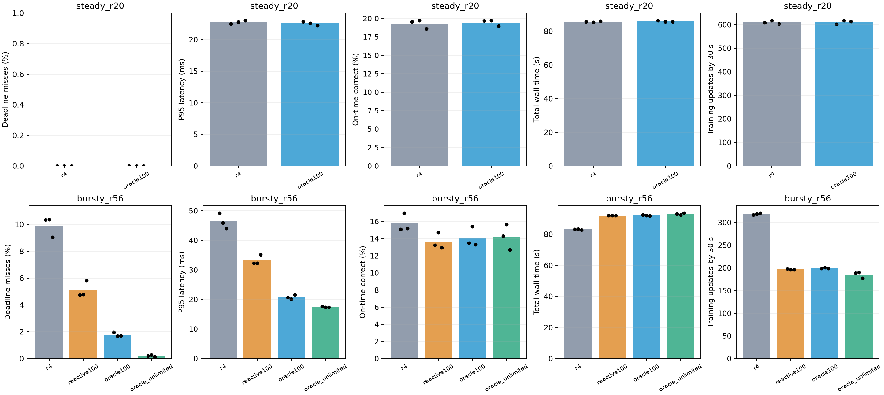
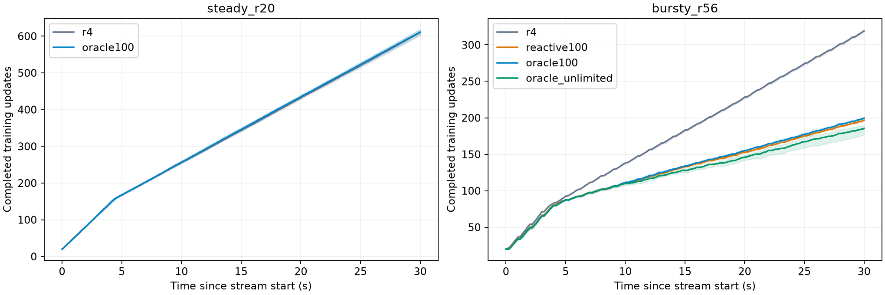

# 已知未来到达：训练启动机会实验

后续已完成[控制训练进度的深入实验](QUOTA_RESULTS.md)：8步/秒时，整窗规划相对无未来信息的均匀调度，超时率7.57%→4.38%，按时正确率17.48%→18.19%，平均训练量相同。下文保留第一轮纯避险策略的结果，两轮预热起点不同，不能直接相减在线正确率。

另见[持续学习质量实验](../arrival_cl/README.md)：对齐类别变化与标签释放，单独评估阶段模型、最终准确率、适应和遗忘。共同工作整窗对照改善了超时与按时正确率，最终模型及适应时间相同；尚未取得稳定的学习质量提升。

2026-10-17，NVIDIA Thor / MAXN。完成 **18 次正式 GPU 对照及 2 次独立 pilot**。正式对照共108,000个请求、18,960次训练更新，各次均完成规定训练与最终10,000样本测试；同设置、同种子的最终权重及BN缓冲完全一致。

**准确的未来到达信息能显著减少训练阻塞造成的超时，但本次纯避险策略牺牲了训练进度，未提高相对 R4 的按时正确率。** 在 R56 突发场景，有等待预算的 oracle 将超时率从9.91%降至1.78%；不限制等待时降至0.21%。对应按时正确率从15.76%降至14.07%／14.21%。三个种子的方向一致。

## 正式结果

每格为种子211、307、419的均值。P95／P99是各次分位数的均值；按时正确率的分母为全部到达请求，逾期请求也全部处理、计分。总墙钟包含初始化、warmup、全部训练、请求、最终测试与退出。

### 突发：R56 / 1 epoch / 33 ms SLO

| 策略 | 超时率 % | P95 ms | P99 ms | 在线正确率 % | 按时正确率 % | 总墙钟 s | 30秒时训练步数 |
|---|---:|---:|---:|---:|---:|---:|---:|
| R4，空队列立即训练 | 9.906 | 46.40 | 60.45 | 17.47 | 15.76 | 83.12 | 319.0 |
| 反应式等待，100 ms预算 | 5.106 | 33.22 | 55.52 | 14.35 | 13.61 | 92.03 | 196.7 |
| 未来到达 oracle，100 ms预算 | 1.778 | 20.79 | 44.93 | 14.36 | 14.07 | 92.13 | 199.7 |
| 未来到达 oracle，不限等待 | 0.206 | 17.48 | 24.99 | 14.24 | 14.21 | 93.01 | 185.3 |

有预算 oracle 相对 R4：超时率下降 **82.05%**，P95下降55.20%，总墙钟增加10.84%；30秒时少完成119.3步训练，按时正确率下降1.68个百分点。不限等待 oracle 的超时率下降 **97.92%**，总墙钟增加11.90%，按时正确率下降1.54个百分点。所有组最终均完成790步，降低超时没有减少规定训练工作。

未来信息也超出了“等一会”本身的作用：相对使用同类耗时估计、同样100 ms预算的反应式等待，有预算 oracle 的超时率再下降 **3.33个百分点**，按时正确率提高 **0.46个百分点**，总墙钟仅增加约0.10秒，30秒时训练步数还多3步。这两项指标在三个种子上均改善。

| 种子 | R4超时率 % | 反应式超时率 % | 有预算oracle超时率 % | 不限等待oracle超时率 % | 有预算oracle按时正确率变化 / pp，相对R4 | 不限等待oracle按时正确率变化 / pp，相对R4 |
|---|---:|---:|---:|---:|---:|---:|
| 211 | 10.333 | 4.733 | 1.950 | 0.217 | −1.583 | −0.783 |
| 307 | 10.350 | 4.783 | 1.683 | 0.267 | −1.583 | −1.333 |
| 419 | 9.033 | 5.800 | 1.700 | 0.133 | −1.883 | −2.517 |

### 平稳：R20 / 2 epochs / 100 ms SLO

| 策略 | 超时率 % | P95 ms | P99 ms | 总墙钟 s | 主动空等 s |
|---|---:|---:|---:|---:|---:|
| R4 | 0 | 22.78 | 25.31 | 85.64 | 0 |
| 有预算oracle | 0 | 22.58 | 25.23 | 85.96 | 0 |

六次运行均零超时。训练计算段中位数约19.4 ms，明显短于100 ms SLO，oracle没有触发主动等待；约0.37%的墙钟差不构成吞吐改进。该场景没有显示训练启动避让的收益空间。



## 为什么超时改善而按时正确率下降

R56完整批训练计算段的中位数约53.5 ms，长于33 ms时限。三个R4基线共1783次超时，其中1718次的请求在训练计算段内到达。修改空队列时的训练启动决定，可以直接避开这类窗口。

代价包含主动空等和小批推理增多。有预算oracle平均主动空等5.74秒；推理调用从R4的1262.7次增至1785.3次，累计推理耗时从9.31秒增至12.53秒，控制耗时从0.37秒增至0.50秒。这些变化解释了约9秒的总墙钟增加。请求服务时平均训练进度从178.8步降至127.8步，当前参数推理使用的是更早训练阶段的模型。

逐请求配对可以把按时正确率的变化精确分成两项。设`O`表示按时完成，`C`表示预测正确，`b`表示基线，`n`表示新策略：

`Δ = mean[C_b × (O_n − O_b)] + mean[O_n × (C_n − C_b)]`

| 相对R4 | 仅改变按时状态的贡献 / pp | 服务时预测结果改变的贡献 / pp | 按时正确率净变化 / pp |
|---|---:|---:|---:|
| 有预算oracle | +1.367 | −3.050 | −1.683 |
| 不限等待oracle | +1.700 | −3.244 | −1.544 |

按时完成状态改善救回了一部分正确预测，但服务时模型状态的变化带来了更大的损失。这支持后续单独估计训练价值：较早完成哪些更新、能改善哪些后续请求，不能由超时风险或训练步数独自决定。



## oracle的剩余超时

有预算oracle的320次超时中，279次请求在预算耗尽后强制启动的训练段内到达。不限等待oracle的37次残余超时全部对应到达时正在训练、且实际计算段长于启动时估计的情况，集中在第79–86步。进入Replay拼批阶段时，训练计算段从约26 ms升至约53 ms，而滚动成本估计尚未追上。

因此，准确到达信息解决的是“未来什么时候有请求”。它仍需要合适的执行成本估计，才能判断当前动作真正阻塞到何时。本实验没有提供未来实际耗时特权。

## 实现与项目执行语义

训练路径由`main.py → run_boundary → train_worker → Replay`运行。实验保持`stream_fifo + cooperative`：训练数据读取每8个样本提供检查机会；GPU forward/backward/optimizer段不可抢占，完成后同步CUDA。原R4及历史R6在空队列时直接返回训练，新的训练启动控制进入的正是这个分支。

| 路径 | 推理使用的模型 | 更新生效时间 | 本实验关系 |
|---|---|---|---|
| `stream_*` | 训练模型的当前参数 | 一步更新完成后的后续服务 | 本次测量对象 |
| `r4_full_eval` | experience结束时发布的独立快照 | 下一轮加载快照；整轮固定版本 | 需要单独考虑发布和加载边界 |
| 原AOCL／全并行 | 独立评估进程读取模型快照 | 取决于发布、读取及进程调度 | 不作为本次外部到达SLO的配对基线 |

推理保留R4的模型模式、Python／NumPy／Torch随机数状态恢复，不更新BN或优化器。延迟从名义到达时刻计到结果完成，包含排队、准备、传输和推理。

`--stream_start_policy`默认`immediate`，保持R4决策；实验选择`reactive`或`oracle`。oracle只读取未来到达时间戳，用FIFO批处理模拟比较“现在训练”与“保持服务就绪”的额外超时数；有额外风险时等待下一次到达、服务后重新判断。训练成本取最近至多64次计算段p90×1.1，推理成本沿用R4在线估计。反应式策略只看过去响应，等待`max(0,T+I(1)−SLO)`长的安静期，不读取未来时间戳。两者都不使用未来样本标签或正确率。

`--stream_start_max_wait_ms 100`限制每次更新前累计主动sleep，服务与准备时间另计；`0`表示不限等待。100 ms不是总训练停顿上界：有预算oracle的平均运行内最长停顿约0.44秒，不限等待时约0.82秒。完整冻结方法见[DESIGN.md](DESIGN.md)。

## 结果能支持什么

已经证明：现有执行机制下存在很大的训练启动避让空间，未来到达信息比本次简单反应式等待更有效。纯避险oracle相对R4仍损失按时正确率，下一阶段应先在oracle信息下加入训练进度／价值约束，寻找延迟和在线质量的较好运行点，再评估简单周期／到达率预测能取得其中多少收益。

这里的oracle采用局部动作比较、有限前瞻和因果耗时估计，是可实现的理想信息参照，未求解所有可行调度的数学最优上界。突发流由每秒前200 ms的高负载和随机到达组成；oracle还能利用偶然出现的空隙，这部分未必能从历史准确预测。训练流与推理样本仍相互独立，没有共同的随时间变化的环境和标签释放机制；结果用于评估30秒合成流上的阻塞与在线质量，分布适应速度需另外验证。

## 环境、验证与复现

Thor物理GPU0、aarch64、MAXN，Conda `rtcl`，Python3.11.16、PyTorch2.14.0+cu132、torchvision0.29.0+cu132；Avalanche固定提交加项目补丁。CPU库线程均为1，GPU对照串行执行，后台服务保持运行。本机当前MAXN与历史R6的120W记录不同，所有收益均相对本次重跑的配对R4计算。

- 每次6000个唯一请求、30秒到达窗口、训练batch64、推理最多32、最终完整10000样本测试。平稳／突发分别完成1580／790步。
- 18/18正式运行及2/2 pilot有效，同设置同种子的到达轨迹、最终权重和BN缓冲一致；逐请求重算超时、分位数、在线及按时正确率。
- 59项单元测试通过；6种实际GPU执行配置的环境检查通过，最终模型一致。
- pilot使用seed19，不并入正式均值：R4→有预算oracle超时率8.78%→1.23%，总墙钟82.82→92.28秒，按时正确率14.93%→14.48%。正式参数在pilot后保持不变。

归档包含[逐次结果](thor-20261017/main/results.csv)、[均值及样本标准差](thor-20261017/main/summary.csv)、[逐种子比较及正确率分解](thor-20261017/main/paired_comparisons.csv)、[逐请求复核结果](thor-20261017/main/audited_results.csv)、[预定矩阵](thor-20261017/main/plan.json)、[执行环境](thor-20261017/main/execution_environment.json)、[GPU验证](thor-20261017/validation.json)和[单元测试记录](thor-20261017/tests.txt)。图表同时提供PDF。

原始日志、逐请求／训练段／启动决策JSON与运行源码保存在`output/thor-arrival-oracle-20261017/`。每次工作目录为`main/work/<case>_<mode>_seed<seed>/`；`stream_requests.json`记录响应及服务时训练进度，`stream_training.json`记录计算段，`stream_train_starts.json`记录等待、成本估计和预算耗尽。

```bash
bash environment/run.sh experiments/optimization/arrival_oracle/run_matrix.py \
  --phase pilot --gpu 0 --output output/arrival-oracle-repeat/pilot
bash environment/run.sh experiments/optimization/arrival_oracle/run_matrix.py \
  --phase main --gpu 0 --output output/arrival-oracle-repeat/main
bash environment/run.sh experiments/optimization/arrival_oracle/analyze.py \
  --directory output/arrival-oracle-repeat/main
```
