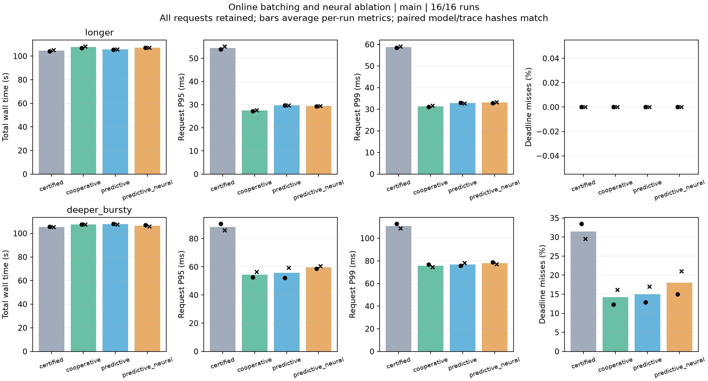
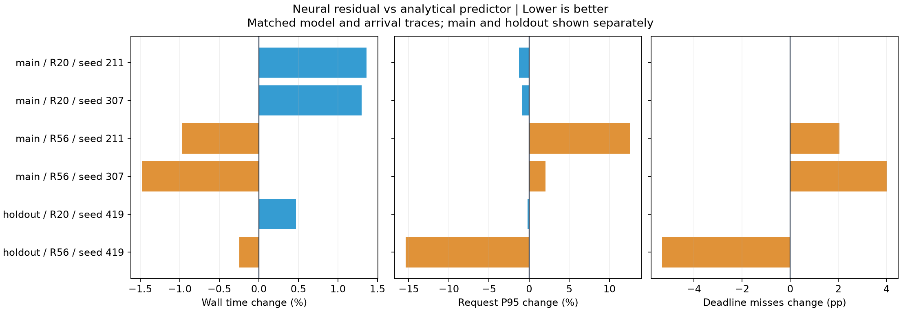

**Thor 第五轮实验与收益观测 · 2026-10-15**

本机完成全部 23 次 GPU 运行：pilot 3/3、正式矩阵 16/16、独立验证 4/4，累计处理 138,000 条在线请求和 28,440 次训练更新。合作式主机准备服务点取得明确的尾延迟改善；预测攒批仅在平稳设置表现出小幅耗时收益；133 参数神经残差尚未带来稳定、可归因的系统收益。

正式矩阵的两种子均值显示：

- `certified → cooperative`：平稳设置 P95 降低 **49.67%**、P99 降低 46.67%，总耗时增加 2.65%；突发设置 P95 降低 **38.26%**、P99 降低 31.72%，超时率从 **31.492% 降至 14.242%**，总耗时增加 2.02%。在线准确率分别降低 0.75、0.36 个百分点，最终训练模型保持一致。
- `cooperative → predictive`：平稳设置总耗时减少 **1.77%**，P95 增加 8.24%；突发设置总耗时增加 0.24%，超时率增加 0.75 个百分点。攒批没有形成跨设置的稳定优势。
- `predictive → predictive_neural`：平稳设置总耗时增加 **1.33%**；突发设置总耗时减少 1.22%，但 P95 增加 6.99%，超时率增加 **3.03 个百分点**。独立种子的结果见下表。

下表为正式矩阵每格两个种子（211、307）的算术均值。P95/P99 为各次运行分位数的均值；有效训练样本/s 为各次 `50,000 × epoch / wall_sec` 的均值，不计 Replay 重放样本。逐次结果及样本标准差见[汇总 CSV](thor-20261015/summary.csv)。

| 设置 | 策略 | 总耗时 s | 有效训练样本/s | P95 ms | P99 ms | 超时率 % | 在线准确率 % |
|---|---|---:|---:|---:|---:|---:|---:|
| 平稳 / R20 | certified | 104.83 | 954.0 | 54.51 | 58.78 | 0.000 | 18.150 |
| 平稳 / R20 | cooperative | 107.60 | 929.4 | 27.44 | 31.35 | 0.000 | 17.400 |
| 平稳 / R20 | predictive | 105.70 | 946.1 | 29.70 | 32.79 | 0.000 | 18.017 |
| 平稳 / R20 | predictive_neural | 107.11 | 933.6 | 29.37 | 33.08 | 0.000 | 17.742 |
| 突发 / R56 | certified | 105.44 | 474.2 | 88.25 | 110.79 | 31.492 | 16.100 |
| 突发 / R56 | cooperative | 107.57 | 464.8 | 54.48 | 75.64 | 14.242 | 15.742 |
| 突发 / R56 | predictive | 107.82 | 463.7 | 55.75 | 76.96 | 14.992 | 15.975 |
| 突发 / R56 | predictive_neural | 106.51 | 469.5 | 59.64 | 77.89 | 18.025 | 16.133 |

神经版相对解析预测版的逐种子变化如下。负的耗时、P95 和超时率变化表示改善；在线准确率变化以正值表示改善。正式矩阵与独立验证分别报告。

| 阶段 / 设置 | 种子 | 总耗时变化 % | P95 变化 % | 超时率变化 / 百分点 | 在线准确率变化 / 百分点 |
|---|---:|---:|---:|---:|---:|
| main / 平稳 | 211 | +1.36 | −1.25 | 0.000 | 0.000 |
| main / 平稳 | 307 | +1.30 | −0.93 | 0.000 | −0.550 |
| main / 突发 | 211 | −0.97 | +12.61 | +2.050 | −0.033 |
| main / 突发 | 307 | −1.48 | +2.05 | +4.017 | +0.350 |
| holdout / 平稳 | 419 | +0.47 | −0.19 | 0.000 | +0.050 |
| holdout / 突发 | 419 | −0.25 | −15.35 | −5.317 | −0.183 |

独立突发种子是局部正向样本：P95 从 61.50 ms 降到 52.06 ms，超时率从 19.917% 降到 14.600%；其方向与两个正式种子相反。平稳设置下，三个种子的神经版均更慢，P95 改善较小且 P99 未一致改善。

网络确实完成在线学习。平稳设置的三个种子分别更新 210、209、211 次，在线更新前的对数 MAE 相对解析基础预测降低约 8.9%、7.7%、8.9%，但仅直接改变 **2/2444、4/2400、1/2459** 次决策。三个突发种子的直接动作改变次数均为 **0**。该计数比较同一现场状态下有无神经残差的即时决策，不是完整反事实轨迹；独立突发组的延迟下降不能据此归因于更好的学习动作选择。正式矩阵中，神经版平均控制耗时在平稳设置由 0.822 s 增至 0.991 s，突发设置由 0.568 s 增至 0.615 s；总墙钟变化还包含执行时序与主机波动。

当前证据支持将合作式 FIFO 保留为时延优先的实验对照；解析攒批提供一个平稳负载下的小幅吞吐取舍点。神经版继续作为消融候选，不启用为默认。33 ms 突发设置仍存在明显超时，当前结果不表示已满足该负载的服务目标。结论覆盖 CIFAR10、两种联合压力设置及当前 Thor 环境；正式每格两个种子、独立每格一个种子，属于小样本观测。

实验使用源码基线 `57b715c`，沿用 [DESIGN.md](DESIGN.md) 的参数和轮换顺序，未调整算法控制律。Conda `rtcl`：Python 3.11.16、PyTorch 2.14.0+cu132、torchvision 0.29.0+cu132、Avalanche `eb075be393e1f458b2c352514ff6c17b5a2c0f4e` 加项目补丁，物理 GPU 0 / NVIDIA Thor，原有 120W 电源模式，OMP/MKL/OpenBLAS 线程数均为 1。运行起始主机负载为 2.83–4.25。环境和数据准备在性能计时之前完成。

两种设置均使用 SplitCIFAR10、Replay、训练批量 64、推理最大批量 32、6,000 个唯一请求 / 30 秒到达窗口：平稳组 ResNet20 / 2 epochs / 100 ms SLO，突发组 ResNet56 / 1 epoch / 33 ms SLO。`certified` 只使用结构证书，`cooperative` 在主机准备中增加 FIFO 服务点，后两组在相同合作式路径上增加解析预测及神经残差。所有组均无推理输入缓存，处理并计分全部逾期请求；网络不改变训练数据、优化器或训练批量。

请求时钟在 20 次训练更新后开始；延迟从预定到达计至响应同步完成，包含排队、训练阻塞、数据准备、传输与推理。总墙钟包含进程导入、初始化、warmup、全部训练和请求、最终完整 10,000 样本测试及退出。在线准确率按请求服务时的模型计分，最终准确率按训练结束后的全测试集计分。调度改变请求遇到的训练进度，因此最终模型一致不保证在线准确率一致。

全部 23 次有效运行完成预定的 1,580 / 790 次训练更新和最终测试；同设置、同种子的模型权重与 BN 缓冲哈希、请求轨迹哈希逐一一致，数据后端证书均成功且零回退。平稳组种子 211 / 307 / 419 的最终准确率为 35.32% / 39.43% / 42.31%；突发组为 18.12% / 19.50% / 15.42%。三阶段分析均从逐请求记录重算延迟分位数、超时率、goodput 和在线准确率，并核对模型、轨迹、训练量与最终测试。一次暂停造成的未完成运行保留在 `main/interrupted/`，恢复后重跑该单元，未计入性能统计。

汇总表、逐次指标、环境记录和图表归档于 `thor-20261015/`，随报告纳入 Git。原始日志、逐请求 JSON 和中断记录保留在本机 `output/thor-round5-20261015/`，不纳入 Git；逐请求复核使用本机原始产物。归档中的汇总脚本可由三阶段指标表和分析 JSON 重建汇总表及学习边际效果图：

- [正式结果 CSV](thor-20261015/main/results.csv)、[独立验证 CSV](thor-20261015/holdout/results.csv)、[pilot CSV](thor-20261015/pilot/results.csv)。
- [配对比较 CSV](thor-20261015/paired_comparisons.csv)、[完整汇总 JSON](thor-20261015/observations.json)、[汇总与绘图脚本](thor-20261015/observations.py)。
- [正式分析](thor-20261015/main/main_summary.json)、[独立验证分析](thor-20261015/holdout/holdout_summary.json)、[环境记录](thor-20261015/environment.json)、[运行上下文](thor-20261015/run_context.json)。
- [正式对比 PDF](thor-20261015/main/main_comparison.pdf)、[学习边际效果 PDF](thor-20261015/learning_effects.pdf)。

其他机器上的结果分别见 [RTX 5090 阶段报告](README.md)和[论文 AE](../../../docs/artifact-evaluation.md)；其耗时与准确率不并入本机统计。
