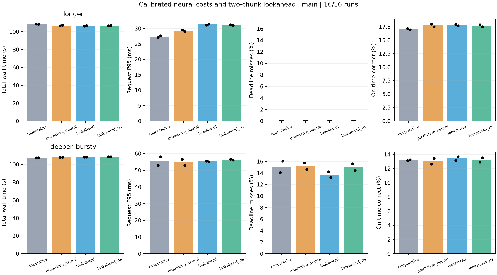

# 第六轮：分阶段成本、校准前瞻与快速神经残差

2026-10-15，NVIDIA Thor。本轮完成 **32 次 GPU 实验**：12 次 pilot、16 次正式对照、4 次独立验证，共192,000个请求和37,920次训练更新。**递归学习显著改善了推理成本预测，但没有兑现为神经模块的系统净收益；无网络新算法的突发改善也未通过独立验证。** 本轮作为失败探索归档，运行实现已回退到 R4；保留方法、数据与结果分析脚本，移除算法模块、运行器、成本预测回放程序和专属测试。

## 方法与实现

第五轮网络只修正推理均值，保护条件仍由解析成本决定，在突发设置下几乎不能改变动作。本轮新增：

1. **分阶段成本。** 在训练计算段同步完成后立即观测，避免把下一段可合作服务的数据准备全部算作不可中断训练；前瞻仍计入下一次准备检查的等待。
2. **快速神经残差。** 保留 9→12 的固定 tanh 特征，训练／推理使用两个独立的 RLS 读出头，含遗忘与截断创新。模型共 146 个参数，其中在线学习 26 个；CPU NumPy 执行，不改 CL 模型、Replay 或训练 batch。
3. **滚动校准。** 用执行前预测与完成耗时的对数误差维护单侧 95% 经验分位数，让学习成本参与延后服务的风险判断。
4. **两段前瞻。** 比较整批服务、先服务一个 FIFO 前缀再服务剩余请求，以及继续一次有界训练／准备操作。只有预测能减少超时时才考虑拆批，并计入额外执行成本。
5. **成本感知检查间隔。** 从响应包络中扣除校准推理成本，在 1–8 ms 内选择准备检查目标；实际服务机会仍受每 8 个样本的读取粒度和其他阻塞影响。

这些是针对现有合作式执行路径的组合原型。RLS、固定神经特征、成本校准与前瞻本身已有研究基础；本轮没有建立论文新颖性。经验分位数也没有硬实时或任意分布漂移下的覆盖保证。完整公式、冻结参数和版本区分见 [DESIGN.md](DESIGN.md)。

| 实验策略 | 入口 | 用途 |
|---|---|---|
| cooperative | `stream_fifo`＋cooperative preparation | 简单 FIFO 对照 |
| predictive_neural | `stream_predictive_neural`＋cooperative preparation | 第五轮 133 参数 SGD 网络对照 |
| lookahead | `stream_lookahead --stream_adaptive_preparation` | 同结构、无网络的消融 |
| lookahead_rls | `stream_lookahead_rls --stream_adaptive_preparation` | 新神经残差与完整新算法 |

表中入口为实验时使用的历史名称，当前命令行已移除。完整公式与冻结参数保留在 [DESIGN.md](DESIGN.md)；对应运行源码保留在本机 `output/thor-round6-20261015/` 各阶段的 `source/` 中。

## 正式矩阵结果

每格两个种子 211、307 的均值。P95／P99 是各次分位数的均值，不是合并请求的分位数。按时正确率的分母是全部到达请求；本轮无丢弃。各次指标和样本标准差见[汇总 CSV](thor-20261015/v3/main/summary.csv)，配对结果见[逐种子比较](thor-20261015/v3/main/paired_comparisons.csv)。

| 设置 | 策略 | 总耗时 s | P95 ms | P99 ms | 超时率 % | 按时正确率 % | 控制耗时 s |
|---|---|---:|---:|---:|---:|---:|---:|
| 平稳 / R20 | cooperative | 108.42 | 27.35 | 31.23 | 0.000 | 17.067 | 0.780 |
| 平稳 / R20 | predictive_neural | 106.92 | 29.30 | 32.83 | 0.000 | 17.742 | 0.996 |
| 平稳 / R20 | lookahead | 106.68 | 31.27 | 35.02 | 0.000 | 17.825 | 1.169 |
| 平稳 / R20 | lookahead_rls | 106.85 | 31.10 | 34.86 | 0.000 | 17.692 | 1.974 |
| 突发 / R56 | cooperative | 107.64 | 55.54 | 76.03 | 15.058 | 13.200 | 0.491 |
| 突发 / R56 | predictive_neural | 107.98 | 54.72 | 74.36 | 15.217 | 13.042 | 0.633 |
| 突发 / R56 | lookahead | 108.21 | 55.32 | 75.10 | 13.717 | 13.425 | 0.898 |
| 突发 / R56 | lookahead_rls | 108.52 | 56.34 | 75.41 | 15.017 | 13.225 | 1.411 |



**神经模块的边际结果**按 `lookahead_rls / lookahead` 的组均值计算：

| 设置 | 耗时变化 % | P95 变化 % | P99 变化 % | 超时率变化 / 百分点 | 按时正确率变化 / 百分点 |
|---|---:|---:|---:|---:|---:|
| 平稳 | +0.15 | −0.53 | −0.47 | 0.00 | −0.13 |
| 突发 | +0.28 | +1.84 | +0.41 | +1.30 | −0.20 |

突发组两个种子的神经版超时率分别增加 1.383、1.217 个百分点，方向一致。神经版平均控制耗时比同结构无网络版增加约 69%／57%。平稳组很小的尾延迟变化不足以抵消耗时和按时正确率的代价。

**无网络新算法的结果**按 `lookahead / cooperative` 的组均值计算：平稳耗时 −1.61%、P95 +14.31%、按时正确率 +0.76 个百分点；突发耗时 +0.54%、P95 −0.40%、超时率 −1.34 个百分点、按时正确率 +0.23 个百分点。不过突发两个种子的超时率变化分别为 **+0.150、−2.833** 个百分点，方向不一致，不能由均值宣称稳定改善；独立验证见下节。

## 独立验证：无网络新算法对 FIFO

预留种子419，参数保持不变；本阶段与正式矩阵分别报告。数据见[独立验证 CSV](thor-20261015/v3/holdout-fifo/results.csv)和[逐请求复核后的比较](thor-20261015/v3/holdout-fifo/paired_comparisons.csv)。

| 设置 | 策略 | 总耗时 s | P95 ms | P99 ms | 超时率 % | 按时正确率 % |
|---|---|---:|---:|---:|---:|---:|
| 平稳 / R20 | cooperative | 109.27 | 27.74 | 32.01 | 0.000 | 17.333 |
| 平稳 / R20 | lookahead | 106.69 | 31.46 | 35.14 | 0.000 | 17.567 |
| 突发 / R56 | cooperative | 107.63 | 49.36 | 74.82 | 13.067 | 13.767 |
| 突发 / R56 | lookahead | 108.54 | 61.09 | 76.49 | 17.517 | 12.967 |

平稳组保持先前取舍：耗时 −2.35%、P95 +13.41%，两者零超时。突发组则明显更差：耗时 +0.84%、P95 +23.78%、超时率 **+4.45 个百分点**、按时正确率 −0.80 个百分点。正式阶段的平均超时改善没有在这一种子上重复出现。

## 预测变准之后发生了什么

下表取正式神经版自身轨迹上的执行前预测，每格两个种子的 MAE 均值；误差为耗时比值的自然对数绝对值，不是分类误差。

| 设置／操作 | 解析基准 log MAE | 神经 RLS log MAE | 相对变化 |
|---|---:|---:|---:|
| 平稳／训练 | 0.01702 | 0.01813 | +6.5% |
| 平稳／推理 | 0.09809 | 0.06159 | −37.2% |
| 突发／训练 | 0.01642 | 0.02264 | +37.9% |
| 突发／推理 | 0.17984 | 0.11609 | −35.5% |

推理拟合明显改善，训练拟合反而变差。预测改进也没有充分进入有价值的执行机会：

| 设置／种子 | 批处理动作分歧／总决策 | 计划检查间隔分歧 | 实际检查门分歧 | 有请求等待时的门分歧 |
|---|---:|---:|---:|---:|
| 平稳／211 | 22 / 2400 | 0 | 0 | 0 |
| 平稳／307 | 23 / 2367 | 0 | 0 | 0 |
| 突发／211 | 5 / 1131 | 174 | 69 | 15 |
| 突发／307 | 6 / 1170 | 220 | 67 | 12 |

平稳组间隔始终截断为 8 ms；突发组虽然有数百次数值改变，但在已有请求等待时，检查门实际分歧只有 15／12 次。这些是同一实际状态下去掉网络的即时比较，不是完整反事实轨迹，不能把运行间的全部性能变化都归因于这些分歧。

分阶段记录还确认，正式神经版训练计算段中位数约为 **23.0 ms（R20）、63.4 ms（R56）**。后者长于 33 ms SLO；训练启动后到达的请求可能被整个计算段阻塞，调整准备检查和成本预测不能消除这部分等待。当前算法在队列为空时仍立即训练，学习成本没有改变这类训练启动决定。

另以相同记录特征回放 SGD、神经 RLS 和直接线性 RLS：平稳推理 log MAE 分别约 0.09364、0.06159、0.06152；突发约 0.18392、0.11609、0.11315。**非线性神经特征的额外必要性也未建立。** 该回放只比较同一记录输入上的预测误差，没有运行线性版本的完整调度闭环，不能由此推断其在线系统收益。数据见[成本预测消融](thor-20261015/v3/main/predictor_replay.json)。

## 实验口径与复核

- 主机为 NVIDIA Thor，Conda `rtcl`，Python 3.11.16、PyTorch 2.14.0+cu132、torchvision 0.29.0+cu132、Avalanche 固定提交加项目补丁；GPU 0，CPU 库线程均为 1，沿用 120W 模式。
- SplitCIFAR10／Replay；平稳 ResNet20、2 epochs、100 ms SLO；突发 ResNet56、1 epoch、33 ms SLO。每次 6,000 个唯一请求、30 秒到达窗口，训练 batch64，推理最多32，最终完整10,000样本测试。
- 请求与训练流仍是第五轮的独立测试／训练数据流，用于系统调度评测。计时包含排队、准备、传输与推理；总墙钟包含进程初始化、全部训练、请求、最终测试与退出。控制耗时包括完整训练期间的成本模型维护。
- 每次保留1580／790次训练更新，处理全部逾期请求；同设置与种子核对最终模型权重／BN缓冲及到达轨迹一致。逐请求重算分位数、超时、在线／按时正确率；新路径另核查成本预测、拆批与检查门记录。
- 47项单元检查通过；环境检查覆盖原路径、新路径和自适应检查组合，共9种配置，实际GPU训练的最终模型哈希一致。见[环境验证](thor-20261015/validation-final.json)和[测试记录](thor-20261015/tests.log)。
- 三轮 pilot 各4次，分别归档，未并入正式矩阵。首个 v1 pilot 与环境检查收尾短暂重叠，仅作为探索记录；正式矩阵与独立验证串行执行。逐版本负结果见 [DESIGN.md](DESIGN.md) 及 `thor-20261015/v1/`、`v2/`、`v3/pilot/`。

本轮两种子正式结果属于探索性证据，尚不支持跨任务、长时间运行或其他硬件的稳定收益结论。

## 踩过的坑与回退结论

- 保留分阶段成本的方法说明、完整决策记录及实验结果，用于解释失败原因；当前运行实现回退到 R4。
- 实验中的 `lookahead` 在100 ms平稳设置观察到较短耗时、较高尾延迟的取舍；突发设置未建立稳定优势。
- 更低预测误差和更多动作分歧没有带来稳定系统收益；神经 RLS 版已移除。现有数据也未建立神经特征相对直接线性读出的必要性。
- 后续算法应先处理长计算段下的训练启动决定及实际服务机会，再评价预测器价值；继续扩大耗时网络缺少本轮证据支持。

## 历史结果复核与证据

以下命令只复核现有逐请求、成本和决策记录：

```bash
bash environment/run.sh experiments/optimization/round6/analyze.py \
  --phase main --directory output/thor-round6-20261015/v3/main
bash environment/run.sh experiments/optimization/round6/analyze.py \
  --phase holdout --directory output/thor-round6-20261015/v3/holdout-fifo
```

汇总、图表、环境、预测器回放结果及探索设计归档于 [thor-20261015/](thor-20261015/)。原始日志、工作目录、逐请求／成本／决策／检查门记录保留在本机 `output/thor-round6-20261015/`，不纳入 Git；原始记录未作改写。各阶段输出的 `source/` 保存对应运行源码，实验矩阵配置另见归档的 `plan.json` 和原始日志命令。当前 R4 实现不能用于重现 R6 方法。
